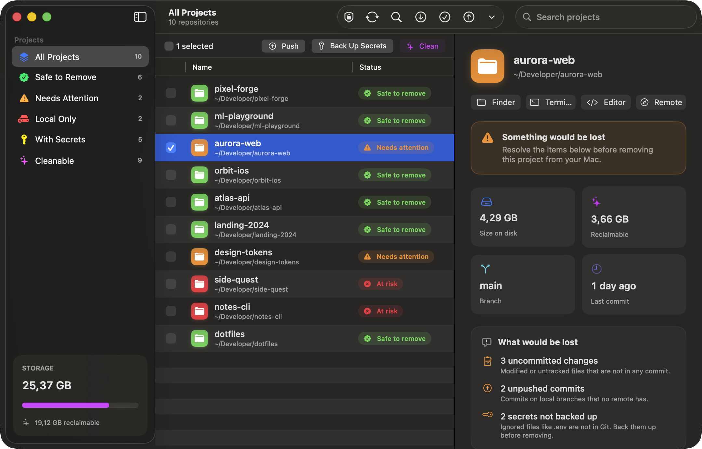

<div align="center">


# Git Manager

**Every Git project on your Mac. One clear answer: can I delete this?**

A native macOS app that finds all your repositories, shows what would be lost if you removed each one,
reclaims gigabytes of `node_modules` and build caches, and keeps your `.env` files safe in an encrypted vault.

[](https://github.com/guibais/git-manager/actions/workflows/ci.yml)
[](https://github.com/guibais/git-manager/releases/latest)


[](LICENSE)

[**Download**](https://github.com/guibais/git-manager/releases/latest) · [**Watch the video**](docs/media/git-manager.mp4) · [Português](README.pt-BR.md)

<a href="docs/media/git-manager.mp4"></a>



</div>

---

## Why

You have 50, 80, 100 projects on your Mac. Some are safely on GitHub. Some have a commit you never pushed.
Some have a `.env` that exists nowhere else. And together they eat 100 GB of disk.

Git Manager answers, for every single project, the only question that matters before you hit delete:

| | Status | Meaning |
|---|---|---|
| 🟢 | **Safe to remove** | Has a remote, nothing uncommitted, nothing unpushed on any branch, no stashes, secrets backed up |
| 🟠 | **Needs attention** | Something would be lost, and the app tells you exactly what |
| 🔴 | **At risk** | No remote at all. This project only lives on this Mac |

## Features

**See everything**
- Scans your Mac for Git repositories, 50+ projects in parallel
- Size on disk, last commit, branch and remotes for every project
- Detects uncommitted changes, unpushed commits on *any* branch, stashes and missing remotes

**Reclaim space**
- Finds regenerable heavy folders: `node_modules`, `.next`, `dist`, `build`, `Pods`, `DerivedData`, `target`, `.venv`, Unity `Library` and more
- Clean one project, a selection, or everything with one click. Source code is never touched

**Act in bulk**
- Checkboxes everywhere: select one, many or all
- Push, Commit & Push, Fetch, Clean, Back up, Move to Trash
- "Remove all" on safe projects, "Clean all" on cleanable ones

**Secrets Vault** 🔐
- Finds ignored secrets: `.env*`, `*.pem`, `*.key`, `GoogleService-Info.plist`, `.npmrc`…
- Backs them up to **your own private Git repository**, for free
- Encrypted on your Mac with **AES-256-GCM** before anything leaves. GitHub only ever sees ciphertext
- Key stored in your Keychain, plus a recovery key you keep in your password manager
- Restore per project, or **Clone & Restore** everything on a new Mac

**Feels like a Mac app**
- SwiftUI, SF Symbols, translucent sidebar, light and dark mode
- Guided onboarding for Full Disk Access, folders, Git and backups
- English and Brazilian Portuguese

## Moving to a new Mac

1. On the old Mac: filter **Needs attention** and fix everything (push, commit, back up secrets)
2. Back up all secrets to your Vault
3. On the new Mac: install Git Manager, connect the same Vault, paste your recovery key
4. Open the Vault and hit **Clone & Restore**. Your projects come back from Git, your secrets from the Vault

## Install

Download the latest `.dmg` from [Releases](https://github.com/guibais/git-manager/releases/latest) and drag **Git Manager** to Applications.

The app is open source and not notarized yet. On first launch, right-click it and choose **Open**, or run:

```bash
xattr -dr com.apple.quarantine "/Applications/Git Manager.app"
```

## Build from source

Requirements: macOS 14+, Xcode 16+.

```bash
git clone https://github.com/guibais/git-manager.git
cd git-manager
swift run                    # run from source
swift test                   # run the test suite
./scripts/build-app.sh       # build "build/Git Manager.app"
```

Demo mode with fake data, useful for screenshots:

```bash
GITMANAGER_DEMO=1 "build/Git Manager.app/Contents/MacOS/GitManager"
```

## How the Vault works

```
secrets-vault/                       (your private repo)
├── .vault.json                      key check, never the key itself
├── index.json
└── github.com/you/my-app/
    ├── manifest.json                paths, SHA-256, dates
    └── files/.env.enc               "GMV1" + AES.GCM sealed box
```

Projects are matched by their remote URL, so restoring works no matter where the folder lives on the new Mac.

## Project structure

```
Sources/GitManager
├── App/        entry point and scenes
├── Models/     Repository, GitSnapshot, issues, vault types
├── Services/   git, scanner, disk usage, vault, crypto, permissions
├── Stores/     RepositoryStore (@Observable)
├── Views/      SwiftUI views, onboarding, vault
└── Resources/  en and pt-BR localizations
video/          Remotion promo video
```

## Releases

Releases are automated with [release-please](https://github.com/googleapis/release-please).
Use [Conventional Commits](https://www.conventionalcommits.org) (`feat:`, `fix:`, `docs:`…). Every push to `main` updates a release PR,
and merging it tags a version, writes the changelog and attaches a universal `.dmg` and `.zip`.

## Contributing

Issues and pull requests are welcome. See [CONTRIBUTING.md](CONTRIBUTING.md).

## License

[MIT](LICENSE)
