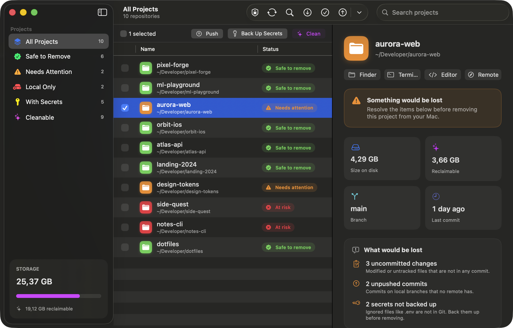

<div align="center">


# Git Manager

**Todos os projetos Git do seu Mac. Uma resposta clara: posso apagar este?**

Um app nativo para macOS que encontra todos os seus repositórios, mostra o que se perderia ao remover cada um,
libera gigabytes de `node_modules` e caches e guarda seus `.env` num cofre criptografado.

[**Baixar**](https://github.com/guibais/git-manager/releases/latest) · [**Ver o vídeo**](docs/media/git-manager.mp4) · [English](README.md)



</div>

## Por quê

Você tem 50, 80, 100 projetos no Mac. Alguns estão seguros no GitHub. Outros têm um commit que você nunca enviou.
Outros têm um `.env` que não existe em nenhum outro lugar. E juntos ocupam 100 GB.

| | Status | Significado |
|---|---|---|
| 🟢 | **Seguro remover** | Tem remoto, nada pendente, nada sem push em nenhuma branch, sem stash, segredos com backup |
| 🟠 | **Atenção** | Algo seria perdido, e o app diz exatamente o quê |
| 🔴 | **Em risco** | Sem remoto. Este projeto só existe neste Mac |

## Recursos

- Encontra todos os repositórios Git, mais de 50 em paralelo
- Tamanho, último commit, branch e remotos de cada projeto
- Limpa pastas pesadas regeneráveis com um clique
- Seleção múltipla: Push, Commit & Push, Limpar, Backup, Mover para o Lixo
- **Cofre de Segredos**: backup dos `.env` num repositório Git privado seu, de graça, criptografado com AES-256 no seu Mac
- **Clonar e Restaurar** tudo num Mac novo
- Onboarding guiado de permissões, inglês e português

## Instalar

Baixe o `.dmg` em [Releases](https://github.com/guibais/git-manager/releases/latest). Na primeira vez, clique com o botão direito e escolha **Abrir**.

## Compilar

```bash
swift run
swift test
./scripts/build-app.sh
```

## Licença

[MIT](LICENSE)
